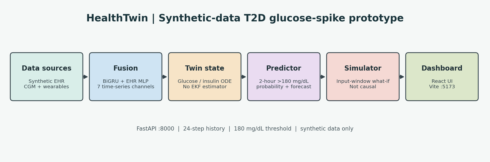

# HealthTwin

[Video](#demo-video) | [Architecture](docs/architecture.pdf) | [Presentation](docs/presentation.pdf) | [License](LICENSE)

## Project Title

HealthTwin: a synthetic-data digital twin prototype for Type 2 diabetes glucose-spike risk prediction.

## Team Details

- Team name: `<<FILL: team name>>`
- Copyright holder: `<<FILL: copyright holder>>` (also required in `LICENSE`)
- Team leader: `<<FILL: your name>>`
- Member: `<<FILL: your name>>` — Team Leader, Developer, and ML Engineer (sole team member)
- Suggested public repository folder: `<<FILL: TeamName>>_NationalEngineeringCollege`

## College / Incubator Information

- College / department: National Engineering College, Kovilpatti, AI & Data Science.
- Incubator: No incubator details provided; confirm with the college before submission.

## Problem Statement

Glucose alerts are often reactive. HealthTwin is a proof-of-concept for estimating whether glucose may exceed 180 mg/dL in the next two hours, presenting the estimate with model-derived factors, and exploring hypothetical changes in a simulated environment. It is not a clinical product and has not been clinically validated.

## Healthcare Use Case

The intended workflow is clinician-supervised review: select a synthetic patient, inspect the glucose and wearable history, review a risk estimate and its contributing factors, then explore a clearly labelled what-if scenario. It is designed around a potential India-focused T2D workflow, including Asian-Indian BMI categories and Indian meal examples where present in the UI. It does not diagnose, prescribe, or replace clinician judgment, and no clinical deployment or workflow integration has been evaluated.

## Technical Stack

| Layer | Technology |
|---|---|
| Data | Python, NumPy, Pandas; procedurally generated synthetic EHR, CGM, and wearable streams |
| ML | PyTorch BiGRU/MLP fusion model; scikit-learn logistic regression; XGBoost baseline; grouped feature explanations |
| Twin model | Bergman-inspired glucose-insulin ODE, meal absorption, activity/sleep/stress/medication inputs |
| Backend | FastAPI, Pydantic, Uvicorn |
| Frontend | React, Vite, React Router, Recharts, Tailwind CSS |
| DevOps | Docker Compose, Make, GitHub Actions (submission checks) |

## AI/ML Model or Framework Details

The classifier consumes a 24-step by 7-channel time-series window (glucose, heart rate, HRV, steps, sleep state, carbohydrates, medication) plus 12 EHR features. A bidirectional GRU and an MLP encode the streams; a fusion head produces a two-hour spike probability and four glucose forecast values. Baselines include XGBoost and logistic regression. The separate twin simulator is an ODE-inspired forward model. The repository does not currently implement the EKF/Bayesian twin state estimator described in earlier planning notes.

The table below is copied from the checked-in `results/metrics.json` snapshot. It is a stored report, not a reproduced evaluation: that file describes 120 patients and balanced labels, while the current processed arrays contain 997,150 train, 213,675 validation, and 213,675 test labels that are all zero; `class_balance.json` also disagrees with the metrics file. No confidence intervals are present in the metrics artifact. Do not interpret these numbers as independently verified or clinically meaningful until the data, model, and evaluation artifacts are regenerated together.

| Model key | Metric | Value |
|---|---|---:|
| fusion_full | auroc | 0.9157 |
| fusion_full | auprc | 0.9221 |
| fusion_full | f1 | 0.8186 |
| fusion_full | ece | 0.0582 |
| ablation_glucose_only | auroc | 0.8142 |
| ablation_glucose_only | auprc | 0.8458 |
| ablation_glucose_only | f1 | 0.6876 |
| ablation_glucose_only | ece | 0.054 |
| ablation_wearables_no_ehr | auroc | 0.908 |
| ablation_wearables_no_ehr | auprc | 0.9128 |
| ablation_wearables_no_ehr | f1 | 0.8136 |
| ablation_wearables_no_ehr | ece | 0.0455 |
| xgboost | auroc | 0.9417 |
| xgboost | auprc | 0.9452 |
| xgboost | f1 | 0.8501 |
| xgboost | ece | 0.0376 |
| logreg | auroc | 0.9059 |
| logreg | auprc | 0.9092 |
| logreg | f1 | 0.8108 |
| logreg | ece | 0.034 |

Limitations include synthetic-only data, rule-based wearable assumptions, no external validation, unverified metric provenance, absent confidence intervals, and acknowledged failed activity/carbohydrate monotonicity checks. See [data documentation](docs/data.md) and [privacy notes](docs/privacy.md).

## Demo Video

Unlisted YouTube video: `<<FILL: YouTube unlisted URL>>`  
Target duration: 20:00-21:00. Upload and verify public-link access before submission.

## Open-Source License

This project is licensed under the [MIT License](LICENSE). No Synthea or third-party wearable dataset is included or claimed as a source; the cohort and wearable streams are locally generated synthetic data. Principal third-party software licenses include PyTorch (BSD-3-Clause), scikit-learn (BSD-3-Clause), XGBoost (Apache-2.0), NumPy (BSD-3-Clause), Pandas (BSD-3-Clause), SciPy (BSD-3-Clause), PyArrow (Apache-2.0), SHAP (MIT), FastAPI (MIT), Uvicorn (BSD-3-Clause), Pydantic (MIT), React (MIT), Vite (MIT), Recharts (MIT), Tailwind CSS (MIT), and ReportLab (BSD-3-Clause). See each installed package's license/notice for the full dependency inventory.

## Architecture Diagram

[Architecture PDF](docs/architecture.pdf)



## Presentation

[Download the presentation PDF](docs/presentation.pdf) (15 slides). It reports the stored metrics snapshot and explicitly notes that confidence intervals and reproducible metrics are unavailable.

## Quickstart

Prerequisites: Docker Engine and Docker Compose v2. The included demo bundle contains one synthetic patient and the small inference artifacts needed by the API.

```bash
docker compose up --build
# Or, equivalently:
make demo
```

Expected URLs: dashboard at <http://localhost:5173>, API health at <http://localhost:8000/health>, and interactive API docs at <http://localhost:8000/docs>. Stop services with Ctrl+C. The larger data-generation/training pipeline is separate and can overwrite generated artifacts; see the Makefile before running it.

## Repo Structure

```text
healthtwin/
|-- .github/workflows/ci.yml
|-- data/demo/                 # Small synthetic P0001 demo stream
|-- docs/                      # Architecture, data/privacy notes, PDFs
|-- frontend/                  # React + Vite application
|-- results/                   # Metrics, small inference artifacts, figures
|-- scripts/                   # Demo-data and submission-check scripts
|-- src/api/                   # FastAPI service
|-- src/data/                  # Synthetic data generation and windows
|-- src/models/                # Training, inference, baselines, explanations
|-- src/twin/                  # ODE-inspired glucose simulator
|-- tests/                     # Python tests
|-- docker-compose.yml
|-- Makefile
|-- requirements.txt
`-- README.md
```

## Disclaimer

All patient records and signals in the included demo are synthetic. This software is not for clinical use, diagnosis, treatment, or medical decision-making. The project aims to minimize privacy risk by using synthetic data and documenting its data flow; this is not a legal certification of DPDP compliance. See [privacy notes](docs/privacy.md).
